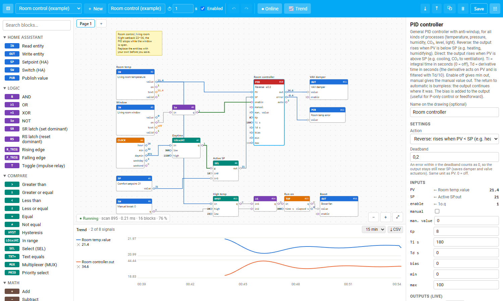

# FBD Logic – function blocks for Home Assistant

Draw logic as a **function block diagram (FBD)** in a sidebar panel in Home Assistant, in the style of IEC 61131-3 and building automation tools. A small PLC-like runtime inside HA runs the programs **cyclically**, and at once when an input changes. The values are always on the wires, and timers, latches and PID controllers keep their state.

*Norsk: [README.nb.md](README.nb.md)*

## Features

- **61 blocks**: logic, compare, math, timers, weekly schedule, PID controller, ramp, filter, HA entities, KNX and Modbus.
- **Live values** on every wire and output, with **forcing** and a **trend** of up to 8 signals.
- **Pages**, **connectors** between pages, and **macros** (your own blocks made of other blocks).
- **Scan on change**: a program reacts within a millisecond of HA getting the change, whatever its cycle time.
- **Online change**: saving reloads the program at once, and unchanged blocks keep their timers, latches and integrators.
- Programs make their own HA entities: setpoints (`number`), switches, and published values (`sensor`/`binary_sensor`).
- **English and Norwegian.**

## Installation

**HACS (custom repository)**

1. In HACS, open the menu (⋮) → **Custom repositories**, add `https://github.com/erikt955/ha-fbd-logic` with the type **Integration**, or use the button above.
2. Download **FBD Logic** and restart Home Assistant.
3. Go to **Settings → Devices & services → Add integration** and search for **FBD Logic**.
4. **Function blocks** shows up in the sidebar (administrators only).

**Manually**: copy the folder `custom_components/fbd_logic` to `/config/custom_components/fbd_logic` (with Samba, File editor, SSH or similar), restart Home Assistant and add the integration as above.

Requires Home Assistant 2024.8 or newer. Tested with 2026.2 and 2026.11.

## Language

- The panel and the blocks follow the language in your HA user profile: Norwegian for Norwegian (nb/nn), English for every other language.
- Warnings on save, block errors and entity names follow HA's system language.
- A program keeps the names it was given. Changing the language does not rename blocks or entities.

## Usage

- **Add blocks**: drag them from the palette on the left, or tap them.
- **Connect**: drag from an output (right side) to an input (left side), or the other way. An input has one wire, so a new wire replaces the old one. Drag a connected input to move its wire.
- **Tidy wires**: pins lie on the grid, so an output and an input can always be put level for a straight wire. Select a wire and drag its bend to move it; double-click the wire for automatic routing again.
- **Constants**: an input without a wire gets a fixed value. Set it in the properties panel; it is shown in grey next to the pin.
- **Save** (Ctrl+S) checks the program and loads it at once. Blocks that have not changed keep their state (online change).
- **Online** shows live values on all outputs. On/off wires turn green when on. A block with an error gets a red frame, and the error is shown in the properties panel.
- `#n` in the top right corner of each block is the execution order.
- **Shortcuts**: Delete, Ctrl+Z/Y, Ctrl+C/V/D, Ctrl+A, the arrow keys, and Shift/Ctrl+drag to select several. The mouse wheel zooms, and dragging the background pans. On a phone, pinch to zoom.
- **Export/import** programs and macros as JSON. [`examples/room_control.fbd.json`](examples/room_control.fbd.json) is a complete example (PID, night setback, window stop and boost); replace the entities before you save it.

### Pages

Large programs can be split into **pages**, the tabs in the top left of the canvas:
- **＋** adds a page, and **✕** deletes the current one.
- Double-click a tab to rename it.
- Move the selected blocks with “Move to page” in the properties panel.

Signals between pages go through **connectors**. A “Connector (sender)” and a “Connector (receiver)” with the same name are connected, on the same page or another one, and the execution order follows the connection. A normal wire to another page is shown as a dashed ⇢ mark with the name of the page.

### Macros (your own blocks)

A macro is a custom block made of other blocks, like a function block (DFB) in a PLC.
- **＋ New → New macro** opens the macro in the same editor.
- “Macro input” and “Macro output” become the pins of the block, in the order of their height on the drawing. Each pin has a name, a type and a default value.
- After **Save**, the macro is under **Macros** in the palette and can be used in every program.
- **Make a macro of the selection**: select several blocks and press the button. The selection is replaced by a macro block, and the wires in and out become pins.
- Each instance has its own state (timers, latches, PID).
- Setpoints, switches and published values inside a macro make their own entities per instance, named after the instance.
- When you change a macro, every program that uses it is reloaded with online change.
- **Show live content** on an instance shows the values inside the macro for that instance.
- A macro can use other macros, but not itself, and a macro that is in use cannot be deleted.

### Forcing

With Online on, every output in the properties panel has a **Force** button:
- The output is locked to the value you enter, and everything connected to it gets that value. This includes Write entity, so the value goes out to the equipment.
- Forced values are shown in orange with an `F` in front, and the status bar shows how many signals are forced.
- **Release** releases one output; “Release all” in the program settings releases all of them.
- Forces stay until released, also after a restart of HA. Use them for commissioning and troubleshooting.

### Trend

📈 in the toolbar opens a trend below the canvas:
- Add signals with 📈 next to an output in the properties panel, or with “Add to trend” on a selected wire. At most 8 signals per program.
- HA samples every second (or every cycle) and keeps the last 60 minutes while HA is running, also when the panel is closed.
- Each signal has its own lane and scale. Hover over the graph to read the values at a point in time.
- **CSV** downloads the values as a table.
- For a longer history, use “Publish value” and HA's own history.

## Blocks

| Category | Blocks |
|---|---|
| Home Assistant | Read entity (state/attribute), Write entity, Setpoint (makes a `number`), Switch (makes a `switch`), Publish value (makes a `sensor`/`binary_sensor`) |
| Logic | AND, OR, XOR (2–8 inputs), NOT, SR, RS, rising/falling edge, toggle |
| Compare | >, ≥, <, ≤, =, ≠, hysteresis, in range, select (SEL), multiplexer (MUX, 2–16 inputs), priority select, text equals |
| Math | +, −, ×, ÷, MIN, MAX, AVG, ABS, LIMIT, linear scaling, round, formula, get bit |
| Time | on delay (TON), off delay (TOF), pulse (TP), pulse generator, clock, run time, counter, weekly schedule |
| Control | PID controller, ramp, rate limiter (separate up/down rates), low-pass filter (PT1) |
| KNX / Modbus | KNX send, KNX listen, Modbus write |
| Other | constant (number / on-off), comment, connector (sender/receiver) |
| Macros | your own macro blocks |

**Weekly schedule** has one or more periods with weekdays and on/off times:
- A period whose off time is before its on time runs past midnight.
- `q` is on in the periods, and `value` gives “value in period” or “value outside period”, for example 21/18 °C.
- `next min` is the number of minutes to the next change.
- The input `enable` (off) switches the schedule off, for example on holidays from a calendar or a `schedule` helper.

**MUX** outputs the input that `k` points to (`in0`, `in1`, …). An invalid index is limited to the nearest input and sets `err`.

**Priority select** has pairs of `g1`/`in1`, `g2`/`in2`, …: the first `g` that is on decides the output, otherwise `else` is used. `idx` is the active priority. It suits manual > alarm > schedule > auto, much like a BACnet priority array.

**Formula** takes up to 8 inputs (`a`–`h`) and an expression such as `a*0.5 + b` or `sel(a > 20, b, c)`. The functions are `abs, min, max, round, sqrt, clamp, sel, floor, ceil, sin, cos, tan, log, log10, exp`. The expression runs in a safe interpreter, not with `eval`.

### PID controller

A general PID controller for all kinds of processes: temperature, pressure, humidity, CO₂, level, light and so on.

- **Form**: the standard (ISA) form, out = bias + Kp · (e + 1/Ti ∫e dt + Td · de/dt).
  - The derivative acts on PV, so a change of SP gives no step from the D term. It is filtered with Td/10.
  - PV and SP can have any unit. Kp is in output units per PV unit, for example %/Pa.
  - Ti = 0 switches the I term off, and Td = 0 the D term.
  - All parameters are inputs, so they can be changed while the program runs.
- **Action**:
  - Reverse: the output rises when PV is below SP. Examples: heating, humidifying, a fan controlled by duct pressure, a filling pump.
  - Direct: the output rises when PV is above SP. Examples: cooling, ventilation controlled by CO₂, dehumidifying, a drain pump.
- **min/max** limit the output, also to negative values (for example −100 to 100). The integrator stops at the limits (anti-windup).
- **enable** off gives min out. **manual** on gives `man. value` out, limited to min/max.
- **Bumpless transfer**: while the controller is off or in manual, the integrator follows the output, so back in automatic the output continues from where it was. After enable off it therefore starts from min. A P-only controller (Ti = 0) has no integrator and goes straight to bias + P.
- **bias** is added to the output, for example 50 % for a P controller, or feedforward from the outdoor temperature.
- **Deadband** (setting): an error within ± the deadband counts as 0, so the output stays still near SP. Outside it the deadband is subtracted, so there is no step at the edge. The `error` output shows the real error.
- **auto** is on when the controller controls by itself, and off when it is off or in manual.
- The integrator is stored and survives both saving the program and restarting HA.
- A step in PV moves the output by Kp × ΔPV at once (the P term); the I term then moves it gradually. If the output moves too much on every small step of a sensor, lower Kp, use the deadband, filter PV with a PT1, or limit the output with a ramp.
- HA is not a real-time system, and many sensors update only every second or less often. The controller is therefore not meant for loops that must react within milliseconds, such as motor speed control.

### KNX and Modbus

The blocks use HA's own KNX and Modbus integrations, which must be set up in HA first.

- **KNX send**: sends to a group address with `knx.send` and the chosen DPT, for example 1.001 on/off, 5.001 percent or 9.001 temperature. “Other DPT…” takes every DPT and type HA supports. On/off values are sent as raw 1/0. The block sends only on change, with deadband, minimum interval and optional cyclic sending.
- **KNX listen**: registers the group address with `knx.event_register`, listens for `knx_event` and outputs the latest value. `new` is a pulse when a telegram arrives. It can send a read request (`knx.read`) on start, and the latest value is kept over a restart.
- **Modbus write**: writes to a holding register (`modbus.write_register`) or a coil (`write_coil`). The data types are int16, uint16, int32, uint32 and float32, and 32-bit values can have the high or the low word first. Raw value = value × scale. The block uses `slave` or `device_address`, whichever your HA version needs.
- **Reading Modbus**: use “Read entity” on a Modbus sensor from your HA configuration. “Get bit” picks single bits out of a status word.

## Entities

Each program becomes a **device** in HA, and its blocks make entities under it:
- A switch that starts and stops the whole program (`switch.<program>_running`, or `_kjorer` in Norwegian).
- **Setpoint** → `number.<program>_<name>`, adjustable from dashboards and automations.
- **Switch** → `switch.<program>_<name>`.
- **Publish value** → `sensor.<program>_<name>` or `binary_sensor.<program>_<name>`; the type follows the signal.
  - The device class is HA's name, for example `temperature`, `carbon_dioxide` or `window`. The field suggests common classes.
  - The unit must fit the class, for example °C for `temperature`, otherwise saving gives a warning.
  - Classes such as `energy` cannot be a measurement in HA, so such a sensor gets no long-term statistics.
  - Every new value is a new state in HA and a row in its database. **Deadband** and **minimum interval** limit that for values that change often; the latest value always gets through.

Setpoints, switches and the state of latches, counters, run time, PID, ramp, rate limiter and filter are stored and survive a restart. The entities are removed when the block or the program is deleted.

## Write entity – what is sent

The action “Automatic” picks the service from the domain and the type of value:

| Domain | On/off signal | Number signal |
|---|---|---|
| light | turn_on/off | brightness % (0 = off) |
| switch, input_boolean, fan, … | turn_on/off | – (fan: percentage) |
| cover, valve | open/close | position % |
| climate, water_heater | turn_on/off | setpoint (temperature) |
| number, input_number | 1/0 | set_value |
| select, input_select | – | select_option |
| button, input_button, script, scene | press on rising edge | – |

You can also choose a fixed action or a **Custom service** (for example `knx.send` with the data field `payload`). The block writes **only on change**, and the deadband and minimum interval limit the traffic further, for example for a PID output to KNX. “Write on start” (on by default) sends the value once when the program starts.

## Execution model

- The programs start when HA has finished starting, so all entities exist.
- A scan reads all inputs and runs the blocks in signal order, from left to right where there is no other order.
- Each program is scanned with a fixed cycle time (0.1–3600 s). A scan typically takes 0.03 ms for a small program and about 0.3 ms for 200 blocks, so 0.1 s is no load.
- **Scan on change** (on by default): the program is also scanned at once when an input changes: Read entity, KNX listen, Setpoint and Switch. The response is then below a millisecond after HA got the change, also with a long cycle time. The cyclic scan still runs, among other things for the timers. Switch it off in the program settings for a purely cyclic program.
  - Several changes at once give one scan, and scans on change come at most every 20 ms per program, so an input that keeps changing, or a feedback loop through HA, cannot overload HA.
  - The status bar shows how many scans came from changes.
- **Feedback** is allowed: the block that closes the loop reads the value from the previous scan.
- An unavailable entity gives `valid = 0`, and the output holds its last value or uses a fallback value (chosen per block).
- An error in one block does not stop the scan. The block keeps its outputs and shows the error.

## Known limitations

- Macros have pins but no parameters of their own, and an entity inside a macro is the same for all instances. Use pins for values that differ.
- The trend history is kept in memory. It is cleared when HA restarts, but the chosen signals are kept.
- Forcing works on outputs. Inputs without a wire are set with their constant.
- Undo/redo lasts until the page is reloaded.
- The panel is made for a computer. On a phone, viewing, live values and small changes work.

## Development

See [CONTRIBUTING.md](CONTRIBUTING.md) for the architecture, the tests and how to add a block or a translation. The changes in each version are in [CHANGELOG.md](CHANGELOG.md).

## License

[MIT](LICENSE)
