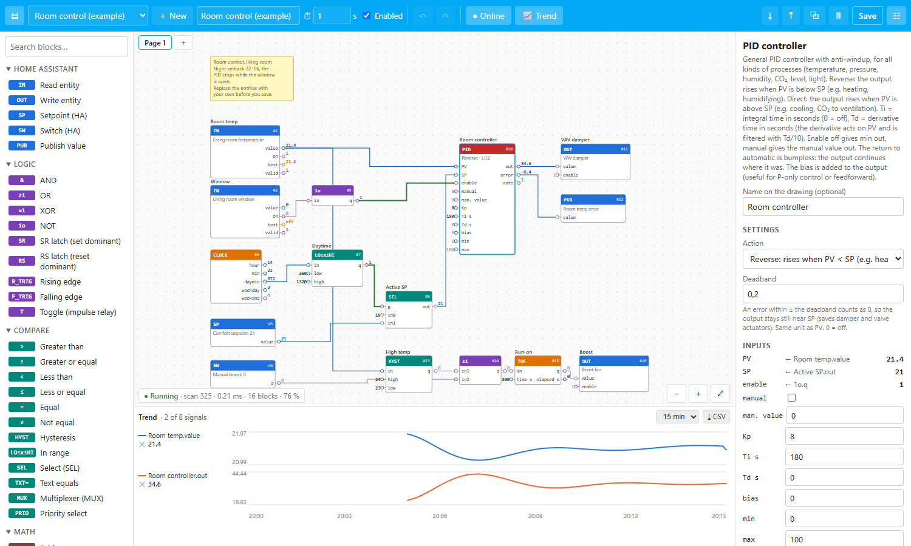

# FBD Logic – funksjonsblokker for Home Assistant

Tegn logikk som **funksjonsblokkdiagram (FBD)** i et eget sidepanel i Home Assistant, omtrent som i IEC 61131-3 og verktøy for byggautomasjon. Programmene kjøres **syklisk** av en liten PLS-lignende motor inne i HA, og i tillegg straks en inngang endres. Verdiene ligger hele tiden på trådene, og timere, låser og PID husker tilstanden sin.

*English: [README.md](README.md)*

## Funksjoner

- **60 blokker**: logikk, sammenligning, matematikk, tid, ukeplan, PID-regulator, rampe, filter, HA-entiteter, KNX og Modbus.
- **Live-verdier** på alle tråder og utganger, med **tvangsstyring** og **trend** for inntil 8 signaler.
- **Sider**, **koblingspunkter** mellom sider og **makroer** (egne blokker satt sammen av andre blokker).
- **Skann ved endring**: programmet reagerer under ett millisekund etter at HA har fått endringen, uansett syklustid.
- **Online-endring**: lagring laster programmet inn med en gang, og blokker som ikke er endret, beholder timere, låser og integratorer.
- Programmene lager egne HA-entiteter: settpunkter (`number`), brytere og publiserte verdier (`sensor`/`binary_sensor`).
- **Norsk og engelsk.**

## Installasjon

**HACS (eget repo)**
1. Åpne menyen (⋮) i HACS → **Custom repositories**, og legg til `https://github.com/erikt955/ha-fbd-logic` med typen **Integration**.
2. Last ned **FBD Logic** og start Home Assistant på nytt.
3. Gå til **Innstillinger → Enheter og tjenester → Legg til integrasjon** og søk etter **FBD Logic**.
4. **Funksjonsblokker** dukker opp i sidemenyen (bare for administratorer).

**Manuelt**: kopier mappen `custom_components/fbd_logic` til `/config/custom_components/fbd_logic` i HA (via Samba, File editor, SSH eller lignende), start HA på nytt og legg til integrasjonen som over.

Krever Home Assistant 2024.8 eller nyere. Testet mot 2026.2 og 2026.11.

## Språk

- Panelet og blokkene følger språket i HA-profilen din: norsk for norsk (bokmål og nynorsk), engelsk for alle andre språk.
- Advarsler ved lagring, feil i blokker og navn på entiteter følger systemspråket i HA.
- Et program beholder navnene det har fått. Å bytte språk gir ikke nye navn på blokker eller entiteter.

## Bruk

- **Legg til blokker**: dra dem fra paletten til venstre, eller trykk på dem.
- **Koble**: dra fra en utgang (høyre side) til en inngang (venstre side), eller motsatt. En inngang kan bare ha én tråd, så en ny tråd erstatter den gamle. Dra i en tilkoblet inngang for å flytte tråden.
- **Konstanter**: innganger uten tråd får en fast verdi. Den settes i egenskapspanelet og vises grått ved pinnen.
- **Lagre** (Ctrl+S) validerer programmet og laster det inn med en gang. Blokker som ikke er endret, beholder tilstanden sin (online-endring).
- **Online** viser live-verdier på alle utganger. Av/på-tråder blir grønne når de er på. Blokker med feil får rød ramme, og feilen vises i egenskapspanelet.
- `#n` øverst til høyre i hver blokk er kjørerekkefølgen.
- **Hurtigtaster**: Delete, Ctrl+Z/Y, Ctrl+C/V/D, Ctrl+A, piltaster og Shift/Ctrl+dra for å velge flere. Musehjulet zoomer, og du drar i bakgrunnen for å panorere. På mobil kan du knipe for å zoome.
- **Eksporter/importer** programmer og makroer som JSON. [`examples/romregulering.fbd.json`](examples/romregulering.fbd.json) er et komplett eksempel (PID, nattsenking, vindusstopp og forsering). Bytt entitetene før du lagrer.

### Sider

Store programmer kan deles i flere **sider**, som fanene øverst til venstre på lerretet:
- **＋** lager en ny side, og **✕** sletter siden du står på.
- Dobbeltklikk på en fane for å gi den nytt navn.
- Valgte blokker flyttes med «Flytt til side» i egenskapspanelet.

Signaler mellom sider går via **koblingspunkter**. En «Koblingspunkt (sender)» og en «(mottaker)» med samme navn er koblet sammen, på samme eller en annen side. Kjørerekkefølgen tar hensyn til koblingen. Hvis en vanlig tråd går til en annen side, vises den som et stiplet ⇢-merke med navnet på siden.

### Makroer (egne blokker)

En makro er en egen blokk satt sammen av andre blokker, som en funksjonsblokk (DFB) i en PLS.
- **＋ Nytt → Ny makro** åpner makroen i samme editor.
- «Makro-inngang» og «Makro-utgang» blir pinnene på blokken, i rekkefølge etter høyden på tegningen. Hver pinne har navn, type og standardverdi.
- Etter **Lagre** ligger makroen under **Makroer** i paletten og kan brukes i alle programmer.
- **Lag makro av utvalget**: velg flere blokker og trykk knappen. Utvalget erstattes med en makroblokk, og trådene inn og ut blir pinner.
- Hver instans har sin egen tilstand (timere, låser, PID).
- Settpunkt, Bryter og Publiser inne i en makro lager egne entiteter per instans. Entitetene får navn etter instansen.
- Når du endrer en makro, lastes alle programmer som bruker den inn på nytt, med online-endring.
- **Vis live innhold** på en instans viser verdiene inne i makroen for akkurat den instansen.
- En makro kan bruke andre makroer, men ikke seg selv, og en makro som er i bruk, kan ikke slettes.

### Tvangsstyring (force)

Med Online på har hver utgang i egenskapspanelet knappen **Tving**:
- Utgangen låses til verdien du skriver inn, og alt som er koblet til den, får den verdien. Det gjelder også Skriv entitet, så verdien går ut til utstyret.
- Tvungne verdier vises i oransje med `F` foran, og statuslinjen viser hvor mange signaler som er tvangsstyrt.
- **Frigi** slipper én utgang. «Frigi alle» under programinnstillingene slipper alle.
- Tvangsstyringer gjelder til de blir frigitt, også etter omstart av HA. Bruk dem til idriftsetting og feilsøking.

### Trend

📈 i verktøylinjen åpner et trendpanel under lerretet:
- Legg til signaler med 📈 ved en utgang i egenskapspanelet, eller med «Legg i trend» på en valgt tråd. Maks 8 signaler per program.
- HA tar prøver hvert sekund (eller hver syklus) og husker de siste 60 minuttene så lenge HA kjører, også når panelet er lukket.
- Hvert signal har sitt eget felt med egen skala. Hold musen over grafen for å se verdiene på et tidspunkt.
- **CSV** laster ned verdiene som en tabell.
- For lengre historikk bruker du «Publiser verdi» og HAs egen historikk.

## Blokker

| Kategori | Blokker |
|---|---|
| Home Assistant | Les entitet (tilstand/attributt), Skriv entitet, Settpunkt (lager `number`), Bryter (lager `switch`), Publiser verdi (lager `sensor`/`binary_sensor`) |
| Logikk | AND, OR, XOR (2–8 innganger), NOT, SR, RS, R_TRIG, F_TRIG, impulsrelé |
| Sammenligning | >, ≥, <, ≤, =, ≠, hysterese, innenfor område, velger (SEL), multiplekser (MUX, 2–16 innganger), prioritetsvelger, tekst lik |
| Matematikk | +, −, ×, ÷, MIN, MAX, AVG, ABS, LIMIT, lineær skalering, avrunding, formel, hent bit |
| Tid | TON, TOF, TP, pulsgenerator, klokke, driftstid, teller, ukeplan |
| Regulering | PID-regulator, rampe, lavpassfilter (PT1) |
| KNX / Modbus | KNX send, KNX lytt, Modbus skriv |
| Annet | Konstant (tall / av-på), kommentar, koblingspunkt (sender/mottaker) |
| Makroer | Dine egne makroblokker |

**Ukeplan** har én eller flere perioder med ukedager og på/av-tid:
- Er av-tiden før på-tiden, varer perioden over midnatt.
- `q` er på i periodene, og `verdi` gir «verdi i periode» eller «verdi utenfor periode», for eksempel 21/18 °C.
- `neste min` er antall minutter til neste skift.
- Inngangen `aktiv` (av) slår planen av, for eksempel på helligdager fra en kalender eller `schedule`-hjelper.

**MUX** gir ut inngangen som `k` peker på (`in0`, `in1`, …). En ugyldig indeks begrenses til nærmeste inngang og setter `err`.

**Prioritetsvelger** har par av `g1`/`in1`, `g2`/`in2`, …: den første `g` som er på, bestemmer utgangen, ellers brukes `ellers`. `idx` er den aktive prioriteten. Velgeren passer til manuell > alarm > tidsprogram > auto, omtrent som et BACnet-prioritetsarray.

**Formel** tar inntil 8 innganger (`a`–`h`) og et uttrykk som `a*0.5 + b` eller `sel(a > 20, b, c)`. Tilgjengelige funksjoner er `abs, min, max, round, sqrt, clamp, sel, floor, ceil, sin, cos, tan, log, log10, exp`. Uttrykket kjøres i en sikker tolk, ikke med `eval`.

### PID-regulator

En generell PID-regulator for alle slags prosesser: temperatur, trykk, fukt, CO₂, nivå, lys og lignende.

- **Formen** er standardformen (ISA): ut = arbeidspunkt + Kp · (e + 1/Ti ∫e dt + Td · de/dt).
  - Derivatet virker på PV, så en endring i SP gir ikke et sprang fra D-leddet. Det er filtrert med Td/10.
  - PV og SP kan ha hvilken som helst enhet. Kp er i utgangsenheter per PV-enhet, for eksempel %/Pa.
  - Ti = 0 slår av I-leddet, og Td = 0 slår av D-leddet.
  - Alle parametrene er innganger, så de kan endres mens programmet kjører.
- **Virkning:**
  - Revers: utgangen øker når PV er under SP. Eksempler: varme, befukting, vifte etter kanaltrykk, fyllepumpe.
  - Direkte: utgangen øker når PV er over SP. Eksempler: kjøling, ventilasjon etter CO₂, avfukting, lensepumpe.
- **min/maks** begrenser utgangen, også til negative verdier (for eksempel −100 til 100). Integratoren stopper ved grensene (anti-windup).
- **aktiv** av gir min ut. **manuell** på gir `man. verdi` ut, begrenset til min/maks.
- **Støtfri overgang:** når regulatoren er av eller i manuell, følger integratoren utgangen. Tilbake i automatikk fortsetter utgangen der den var, uten sprang. Etter aktiv av starter den altså fra min. En ren P-regulator (Ti = 0) har ingen integrator og går rett til arbeidspunkt + P.
- **arb.punkt** legges til utgangen, for eksempel 50 % for en P-regulator eller en foroverkobling fra utetemperaturen.
- **Dødbånd** (innstilling): avvik innenfor ± dødbåndet regnes som 0, så pådraget står stille nær SP. Utenfor trekkes dødbåndet fra, så det blir ikke noe sprang i kanten. Utgangen `avvik` viser det virkelige avviket.
- **auto** er på når regulatoren regulerer selv, og av når den er av eller i manuell.
- Integratoren lagres og overlever både lagring av programmet og omstart av HA.
- Et sprang i PV flytter utgangen med Kp × ΔPV med en gang (P-leddet), og I-leddet flytter den gradvis etterpå. Hopper utgangen for mye for hvert lille trinn fra en sensor, kan du senke Kp, bruke dødbånd, filtrere PV med PT1 eller begrense utgangen med en rampe.
- HA er ikke et sanntidssystem, og mange sensorer oppdateres bare hvert sekund eller sjeldnere. Regulatoren passer derfor ikke til sløyfer som må reagere på millisekunder, som turtallsregulering av motorer.

### KNX og Modbus

Blokkene bruker HAs egne KNX- og Modbus-integrasjoner. De må være satt opp i HA først.

- **KNX send**: sender til en gruppeadresse med `knx.send` og valgt DPT, for eksempel 1.001 av/på, 5.001 prosent eller 9.001 temperatur. «Annen DPT…» tar alle DPT-er og typer HA støtter. Av/på-verdier sendes som rå 1/0. Blokken sender bare ved endring, med dødbånd, minste intervall og valgfri syklisk sending.
- **KNX lytt**: registrerer gruppeadressen med `knx.event_register`, lytter på `knx_event` og gir ut siste verdi. `ny` er en puls når et telegram kommer. Den kan sende en leseforespørsel (`knx.read`) ved oppstart, og siste verdi huskes over omstart.
- **Modbus skriv**: skriver til et holding-register (`modbus.write_register`) eller en coil (`write_coil`). Datatypene er int16, uint16, int32, uint32 og float32, og 32-biters verdier kan ha høy eller lav ordre først. Råverdi = verdi × skala. Blokken bruker `slave` eller `device_address` etter hva HA-versjonen din krever.
- **Lese Modbus**: bruk «Les entitet» mot en Modbus-sensor fra HA-oppsettet. «Hent bit» plukker ut enkeltbiter fra statusord.

## Entiteter som opprettes

Hvert program blir en **enhet** i HA, og blokkene lager entiteter under den:
- En bryter som starter og stopper hele programmet (`switch.<program>_kjorer`, eller `_running` på engelsk).
- **Settpunkt** → `number.<program>_<navn>`, som kan justeres fra dashboard og automasjoner.
- **Bryter** → `switch.<program>_<navn>`.
- **Publiser verdi** → `sensor.<program>_<navn>` eller `binary_sensor.<program>_<navn>`. Typen velges automatisk ut fra signalet.
  - Device class er HA-navnet, f.eks. `temperature`, `carbon_dioxide`, `window`. Feltet foreslår vanlige klasser.
  - Enheten må passe til klassen, f.eks. °C for `temperature`. Ellers får du en advarsel når du lagrer.
  - Klasser som `energy` kan ikke være en måling i HA. Sensoren får da ingen langtidsstatistikk.
  - Hver ny verdi blir en ny tilstand i HA og en rad i databasen. **Dødbånd** og **minste intervall** begrenser det for verdier som endrer seg ofte. Siste verdi kommer alltid fram.

Settpunkter, brytere og tilstanden til låser, tellere, driftstid, PID, rampe og filter lagres og overlever omstart. Entitetene fjernes når blokken eller programmet slettes.

## Skriv entitet – hva som sendes

Handlingen «Automatisk» velger tjeneste ut fra domenet og verditypen:

| Domene | Av/på-signal | Tallsignal |
|---|---|---|
| light | turn_on/off | lysstyrke % (0 = av) |
| switch, input_boolean, fan, … | turn_on/off | – (fan: prosent) |
| cover, valve | åpne/lukk | posisjon % |
| climate, water_heater | turn_on/off | settpunkt (temperatur) |
| number, input_number | 1/0 | set_value |
| select, input_select | – | select_option |
| button, input_button, script, scene | trykk på stigende flanke | – |

Du kan også velge en fast handling eller **Egendefinert tjeneste** (f.eks. `knx.send` med datafelt `payload`). Blokken skriver **bare ved endring**. Dødbånd og minste intervall begrenser trafikken, for eksempel for en PID-utgang mot KNX. «Skriv ved oppstart» (på som standard) sender verdien én gang når programmet starter.

## Kjøremodell

- Programmene starter når HA er ferdig oppstartet, slik at alle entiteter finnes.
- Ett skann leser alle innganger og kjører blokkene i signalrekkefølge, fra venstre mot høyre ved like vilkår.
- Programmet skannes med fast syklustid (0,1–3600 s). Ett skann tar typisk 0,03 ms for et lite program og rundt 0,3 ms for 200 blokker, så 0,1 s er ingen belastning.
- **Skann ved endring** (på som standard): programmet skannes også straks en inngang endres. Det gjelder Les entitet, KNX lytt, Settpunkt og Bryter. Responsen blir da under ett millisekund etter at HA har fått endringen, også med lang syklustid. Det faste skannet går fortsatt, blant annet for timerne. Slå det av under programinnstillingene hvis du vil ha et rent syklisk program.
  - Flere endringer samtidig gir ett skann. Skann ved endring kommer høyst hvert 20. millisekund per program, så en inngang som skifter hele tiden eller en tilbakekobling via HA ikke kan overbelaste HA.
  - Statuslinjen viser hvor mange skann som kom av endringer.
- **Tilbakekobling** er lov. Blokken som lukker sløyfen, leser verdien fra forrige skann.
- Utilgjengelige entiteter gir `gyldig = 0`, og utgangen holder siste verdi eller bruker en reserveverdi (velges per blokk).
- En feil i én blokk stopper ikke skannet. Blokken holder utgangene sine og viser feilen.

## Kjente begrensninger

- Makroer har bare pinner, ikke egne parametere. En entitet inne i en makro er den samme for alle instanser. Bruk pinner for verdier som skal variere.
- Trendhistorikken ligger i minnet. Den nullstilles ved omstart av HA, men signalvalget huskes.
- Tvangsstyring gjelder utganger. Innganger uten tråd styres med konstanten.
- Angre/gjør om gjelder bare til siden lastes på nytt.
- Panelet er laget for PC. På mobil fungerer visning, online-verdier og enkle endringer.

## Utvikling

Se [CONTRIBUTING.md](CONTRIBUTING.md) (engelsk) for arkitektur, tester og hvordan du legger til en blokk eller en oversettelse. Endringene i hver versjon står i [CHANGELOG.md](CHANGELOG.md).

## Lisens

[MIT](LICENSE)
